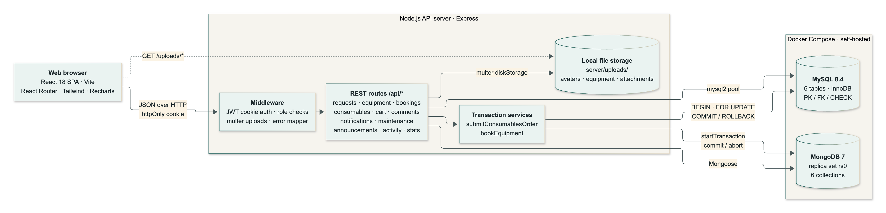
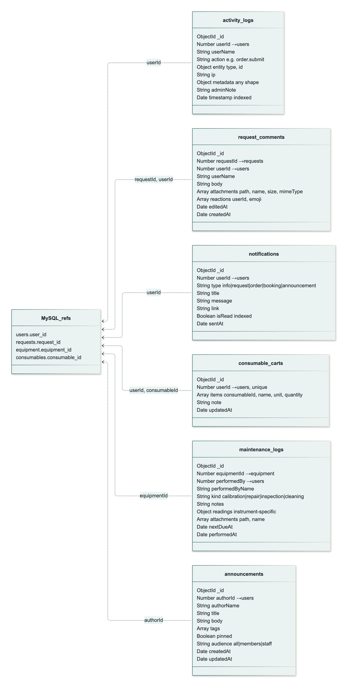
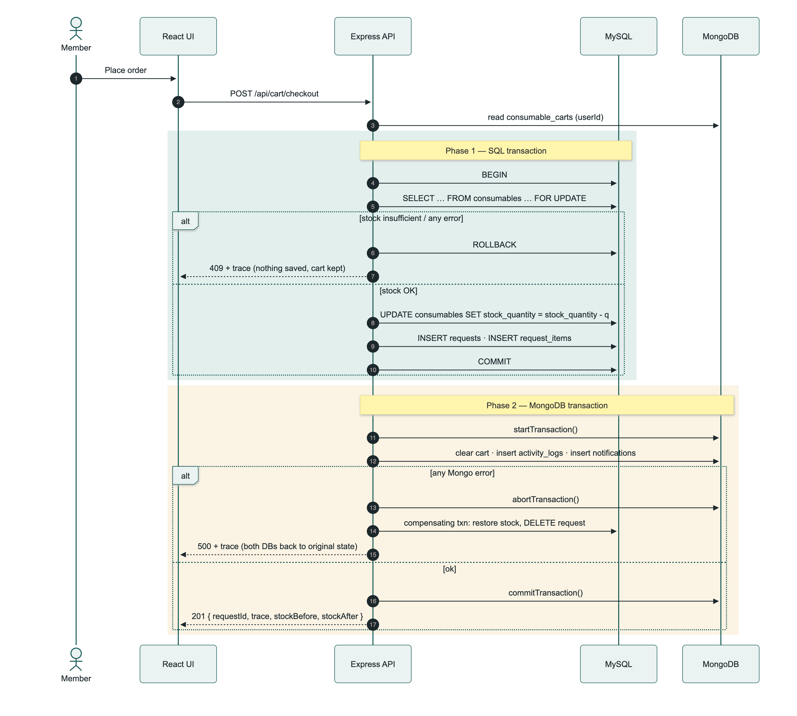

# Labrador — Laboratory Management System

Labrador is a web-based laboratory management application designed to centralize laboratory operations, including user management, equipment management, consumable inventory, requests, bookings, and notifications.

The application uses a **hybrid database architecture**, combining MySQL for relational data and MongoDB for flexible document-oriented data.

---

## 1. Project Overview

### Problem Statement

Research laboratories often rely on spreadsheets, emails, and chat applications to manage daily activities. This makes it difficult to track requests, manage shared equipment, monitor inventory, and coordinate laboratory members.

Labrador provides a centralized platform to manage these operations through a single web application.

### User Roles

| Role   | Permissions                                                                         |
| ------ | ----------------------------------------------------------------------------------- |
| Member | Submit requests, book equipment, order consumables, and participate in discussions. |
| Staff  | Manage requests, equipment, inventory, maintenance, and announcements.              |
| Admin  | Access all features and manage users.                                               |

---

## 2. Technology Stack

| Component      | Technology                       |
| -------------- | -------------------------------- |
| Frontend       | React 18, Vite 6, Tailwind CSS 4 |
| Backend        | Node.js, Express 5               |
| SQL Database   | MySQL 8.4                        |
| NoSQL Database | MongoDB 7                        |
| ORM / ODM      | mysql2, Mongoose                 |
| Authentication | JWT, bcryptjs                    |
| File Upload    | Multer                           |
| Deployment     | Docker Compose                   |

---

## 3. System Architecture

Labrador consists of three main components:

1. **Frontend:** React application that provides the user interface.
2. **Backend:** Express REST API that handles application logic and database operations.
3. **Databases:** MySQL and MongoDB for storing application data.



---

## 4. Database Design

Labrador uses two databases to store different types of information.

### 4.1 MySQL — Relational Database

MySQL stores structured data that requires relationships and data integrity.

The database contains six tables:

| Table                | Description                                       |
| -------------------- | ------------------------------------------------- |
| `users`              | Stores user accounts and roles.                   |
| `equipment`          | Stores laboratory equipment information.          |
| `consumables`        | Stores consumable inventory and stock quantities. |
| `requests`           | Stores laboratory requests and orders.            |
| `request_items`      | Stores items associated with consumable orders.   |
| `equipment_bookings` | Stores equipment reservations.                    |

**Database Constraints:**

- Primary keys and foreign keys.
- Unique constraints.
- CHECK constraints.
- Indexes for frequently queried fields.
- Referential integrity.

**ER Diagram:**


### 4.2 MongoDB — NoSQL Database

MongoDB stores flexible document-oriented data.

The database contains six collections:

| Collection         | Description                                             |
| ------------------ | ------------------------------------------------------- |
| `activity_logs`    | Records application activities.                         |
| `request_comments` | Stores request discussions, attachments, and reactions. |
| `notifications`    | Stores user notifications.                              |
| `consumable_carts` | Stores temporary shopping carts.                        |
| `maintenance_logs` | Stores equipment maintenance records.                   |
| `announcements`    | Stores laboratory announcements.                        |

MongoDB supports flexible document structures and embedded arrays.

**NoSQL Schema Diagram:**



### 4.3 Hybrid Database Usage

| MySQL              | MongoDB          |
| ------------------ | ---------------- |
| Users              | Activity Logs    |
| Equipment          | Request Comments |
| Consumables        | Notifications    |
| Requests           | Consumable Carts |
| Request Items      | Maintenance Logs |
| Equipment Bookings | Announcements    |

MySQL is used for structured relational data, while MongoDB is used for flexible documents.

---

## 5. Core Functionality

Labrador provides the following features:

- User registration, authentication, and role management.
- Equipment management and equipment bookings.
- Consumable inventory management.
- Laboratory request submission and tracking.
- Shopping cart and consumable checkout.
- Request discussions with file attachments.
- Equipment maintenance records.
- User notifications.
- Laboratory announcements.
- Activity logs and usage statistics.

---

## 6. CRUD Operations

All 12 database entities support Create, Read, Update, and Delete operations through the application.

| Entity             | Create               | Read               | Update            | Delete              |
| ------------------ | -------------------- | ------------------ | ----------------- | ------------------- |
| Users              | Register / Add user  | User directory     | Edit profile      | Delete user         |
| Equipment          | Add equipment        | Equipment list     | Edit equipment    | Delete equipment    |
| Consumables        | Add inventory        | Inventory list     | Update inventory  | Delete inventory    |
| Requests           | Submit request       | Request list       | Update request    | Delete request      |
| Request Items      | Create order items   | View order items   | Change quantity   | Remove order items  |
| Equipment Bookings | Create booking       | View bookings      | Reschedule        | Cancel booking      |
| Activity Logs      | Record activity      | View activity      | Annotate          | Delete entry        |
| Request Comments   | Post comment         | View comments      | Edit comment      | Delete comment      |
| Notifications      | Create notification  | View notifications | Mark as read      | Dismiss             |
| Consumable Carts   | Add cart items       | View cart          | Update quantity   | Remove items        |
| Maintenance Logs   | Create record        | View history       | Edit record       | Delete record       |
| Announcements      | Publish announcement | View announcements | Edit announcement | Delete announcement |

---

## 7. Transaction Management

Labrador implements database transactions to maintain data consistency during multi-step operations.

### 7.1 Consumables Checkout

Checkout involves both MySQL and MongoDB.

1. Retrieve the shopping cart from MongoDB.
2. Start a MySQL transaction.
3. Lock inventory rows and verify stock availability.
4. Deduct inventory quantities.
5. Create a request and its order items.
6. Commit the MySQL transaction.
7. Start a MongoDB transaction.
8. Clear the shopping cart and create activity logs and notifications.
9. Commit the MongoDB transaction.

If an operation fails before the MySQL commit, SQL changes are rolled back.

If the MongoDB transaction fails after the MySQL commit, Labrador performs compensating SQL operations to restore stock and remove the created order records.

### 7.2 Equipment Booking

Equipment bookings use MySQL transactions.

1. Start a transaction.
2. Lock the equipment record.
3. Check equipment availability and maintenance status.
4. Check for overlapping bookings.
5. Insert the booking.
6. Commit the transaction.

If validation or insertion fails, the transaction is rolled back.

**Transaction Sequence Diagram:**



---

## 8. Project Setup

### Prerequisites

- Node.js 20 or later.
- Docker Desktop.
- Git.

### 8.1 Clone Repository

```bash
git clone https://github.com/Pandemonium-Abyss/ISP-x-Database.git
cd ISP-x-Database
```

### 8.2 Configure Environment

```bash
cp .env.example .env
```

### 8.3 Install Dependencies

```bash
npm run setup
```

### 8.4 Start Databases

```bash
npm run db:up
```

### 8.5 Initialize Database

```bash
npm run reset
```

This command creates the database tables and inserts sample data.

**Warning:** This command drops and recreates the MySQL tables.

### 8.6 Start Application

```bash
npm run dev
```

Open:

[http://localhost:5173](http://localhost:5173)

### Demo Accounts

All accounts use the password `password123`.

| Role   | Email                    |
| ------ | ------------------------ |
| Admin  | `admin@labrador.local`   |
| Staff  | `somchai@labrador.local` |
| Staff  | `mali@labrador.local`    |
| Member | `ben@labrador.local`     |
| Member | `nicha@labrador.local`   |

---

## 9. API Documentation

All API endpoints use the `/api` prefix and return JSON responses.

Authentication is handled using session cookies.

| Module         | Main Endpoints                                              |
| -------------- | ----------------------------------------------------------- |
| Authentication | `/auth/register`, `/auth/login`, `/auth/logout`, `/auth/me` |
| Users          | `/users`                                                    |
| Equipment      | `/equipment`                                                |
| Consumables    | `/consumables`                                              |
| Requests       | `/requests`                                                 |
| Comments       | `/requests/:id/comments`, `/comments/:id`                   |
| Bookings       | `/bookings`                                                 |
| Shopping Cart  | `/cart`, `/cart/items`, `/cart/checkout`                    |
| Notifications  | `/notifications`                                            |
| Maintenance    | `/maintenance`                                              |
| Announcements  | `/announcements`                                            |
| Activity Logs  | `/activity`                                                 |
| Dashboard      | `/dashboard`, `/stats`, `/db-state`                         |

---

## 10. Testing and Screenshots

### Testing

Run the backend test suite:

```bash
npm --prefix server test
```

The project includes 59 automated tests covering:

- CRUD operations.
- File uploads.
- Database constraints.
- Equipment booking validation.
- Successful checkout.
- Insufficient stock.
- Transaction rollback.

### Screenshots

Application screenshots are available in:

`docs/screenshots/`

The screenshots demonstrate application features, CRUD operations, database diagrams, and transaction behavior.

---

## 11. Documentation

Additional project documentation is available in the `docs/` directory.

| Document              | Description                         |
| --------------------- | ----------------------------------- |
| SRS                   | Software Requirements Specification |
| Iteration Reports 1–5 | Project development reports         |
| Architecture Diagram  | System architecture                 |
| ER Diagram            | MySQL database design               |
| NoSQL Schema Diagram  | MongoDB database design             |
| Sequence Diagrams     | System operation workflows          |
| Presentation          | Project presentation slides         |

---

## 12. Project Deliverables

- **GitHub Repository:** [Pandemonium-Abyss/ISP-x-Database](https://github.com/Pandemonium-Abyss/ISP-x-Database)
- **Presentation Video:** [Watch Labrador Presentation](https://youtu.be/5izrg2WZO20)
- **Presentation Slides:** `docs/Labrador-presentation.pptx`

---

## Project Summary

Labrador is a hybrid database web application that demonstrates the integration of MySQL and MongoDB in a real-world laboratory management system.

It provides complete CRUD operations, database relationships, document-oriented storage, transaction management, and rollback mechanisms through a centralized web application.
