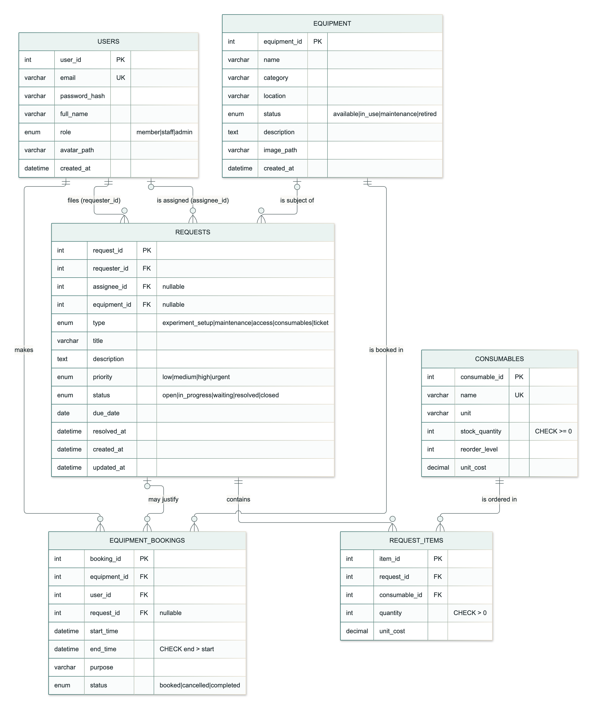

<p align="center">
  
</p>

<h1 align="center">Labrador</h1>

<p align="center">
  Lab operations hub — React + Vite frontend, Express API, MySQL and MongoDB.
</p>

---

**Course:** Individual Software Development Process' 2026 \
**Team:** Wassawin the Goat of All Time (W-GOAT) \
**Chosen IRL Challenge:** Project B Lab Workflow & Request Management

## Team members

| Name                     | Student ID | GitHub                                              |
| ------------------------ | ---------- | --------------------------------------------------- |
| Kantinan Lertluckpreecha | 6810545476 | [LELOUCH2L](https://github.com/LELOUCH2L)           |
| Jedsada Ungsunantwiwat   | 6810545522 | [Jadeung123](https://github.com/Jadeung123)         |
| Pathadon Aougsk          | 6810545808 | [PathadonAougsk](https://github.com/PathadonAougsk) |
| Wassawin Swangjaeng      | 6810545905 | [CYRTRUS](https://github.com/CYRTRUS)               |
| Siraphob Phonphakdee     | 6810545930 | [vaporform](https://github.com/vaporform)           |

## Documents & diagrams

Everything lives in [`docs/`](docs).

### Iteration reports

| Iteration | Report                                                                                          |
| --------- | ----------------------------------------------------------------------------------------------- |
| 1         | [ISP-SKE26 Iteration Report 1 W-GOAT.pdf](docs/ISP-SKE26%20Iteration%20Report%201%20W-GOAT.pdf) |
| 2         | [ISP-SKE26 Iteration Report 2 W-GOAT.pdf](docs/ISP-SKE26%20Iteration%20Report%202%20W-GOAT.pdf) |
| 3         | [ISP-SKE26 Iteration Report 3 W-GOAT.pdf](docs/ISP-SKE26%20Iteration%20Report%203%20W-GOAT.pdf) |
| 4         | [ISP-SKE26 Iteration Report 4 W-GOAT.pdf](docs/ISP-SKE26%20Iteration%20Report%204%20W-GOAT.pdf) |
| 5         | [ISP-SKE26 Iteration Report 5 W-GOAT.pdf](docs/ISP-SKE26%20Iteration%20Report%205%20W-GOAT.pdf) |

### Specs & diagrams

| File / folder                                                  | Contents                           |
| -------------------------------------------------------------- | ---------------------------------- |
| `docs/ISP-SKE-26 3 Wassawin the Goat of All Time (W-GOAT).pdf` | Software Requirement Specification |
| `docs/use_case_diagram/`                                       | Use case diagram                   |
| `docs/sequence_diagram/`                                       | Sequence diagrams (SQD-1 … SQD-7)  |
| `docs/activity_diagram/`                                       | Activity diagrams (AD-1 … AD-6)    |
| `docs/gantt_chart/`                                            | Project Gantt chart                |
| `docs/diagrams/`                                               | Architecture, ER, NoSQL schema and checkout-sequence diagrams (PNG/SVG + Mermaid sources) |
| `docs/screenshots/`                                            | 38 annotated screenshots of the app                                                     |
| `docs/Labrador-presentation.pptx`                              | 10-slide presentation (speaker notes included)                                          |


---

**Labrador** is a self-hosted web application that replaces the email threads, chat messages and
ad-hoc spreadsheets a research lab uses to run day-to-day work. Members file and track requests,
book shared equipment, order consumables and discuss work in threads; staff triage a single
prioritised queue; everyone sees what is going on in the lab and how resources are used over time.

It is built on a **hybrid database architecture**: **MySQL** holds the relational core that needs
strict integrity (users, equipment, inventory, requests, bookings) and **MongoDB** holds the
flexible, high-volume documents (comments, notifications, carts, audit logs, maintenance readings,
announcements). Multi-step operations run as **atomic transactions with explicit rollback** across both.

> 🎥 **Presentation video:** _add your link here_  ·  📑 **Slides:** [docs/Labrador-presentation.pptx](docs/Labrador-presentation.pptx) (10 slides, speaker notes included)

---

## Contents
1. [The problem and the solution](#1-the-problem-and-the-solution)
2. [Tech stack](#2-tech-stack)
3. [System architecture](#3-system-architecture)
4. [Database design](#4-database-design)
5. [Transactions & rollback](#5-transactions--rollback)
6. [CRUD coverage](#6-crud-coverage)
7. [Setup & running locally](#7-setup--running-locally)
8. [Environment variables](#8-environment-variables)
9. [API reference](#9-api-reference)
10. [Project structure](#10-project-structure)
11. [Testing & screenshots](#11-testing--screenshots)

---

## 1. The problem and the solution

| Problem in the lab today | How Labrador solves it |
|---|---|
| Requests (experiment setup, maintenance, access, consumables, "fix this script") are lost in email/chat | One **request queue** with type, priority, status, assignee and due date |
| Priorities are unclear | Requests are sorted urgent → low; staff see an **unassigned / assigned-to-me queue** |
| Follow-up is hard to track | Every request has a **discussion thread** with attachments, and every change triggers **notifications** |
| Equipment gets double-booked or used while broken | **Bookings** check overlaps inside a locked SQL transaction; equipment in maintenance cannot be booked |
| Consumables run out unnoticed | Live **inventory** with reorder levels, low-stock alerts, and an atomic **cart → order** checkout |
| No visibility of resource use over time | **Usage & insights**: requests per week, resolution time, equipment hours, consumables spend, activity |
| New members don't know what's going on or how to ask for help | **Dashboard** + pinned **announcements** + guided **New request** form |

Roles: **member** (file requests, book, order, comment), **staff** (triage, manage equipment/inventory,
log maintenance, post announcements), **admin** (everything + user management + rollback demo switches).

## 2. Tech stack

| Layer | Technology |
|---|---|
| Frontend | React 18, Vite 6, React Router 6, Tailwind CSS 4, Recharts, lucide-react icons, self-hosted fonts (`@fontsource`) |
| Backend | Node.js (ESM), Express 5, `mysql2/promise`, Mongoose 9, `jsonwebtoken` (httpOnly cookie), `bcryptjs`, `multer` |
| Relational DB | **MySQL 8.4** (InnoDB, foreign keys, CHECK constraints, row locks) |
| Document DB | **MongoDB 7** as a single-node **replica set** (`rs0`) — required for multi-document transactions |
| Files | Stored on the server's local disk in `server/uploads/{avatars,equipment,attachments}` |
| Infrastructure | Docker Compose for both databases |

**Fully self-contained:** no external APIs, no cloud databases, no CDN, no third-party image hosting.
Fonts and icons are bundled from npm.

## 3. System architecture


The React SPA talks JSON to the Express API (in development Vite proxies `/api` and `/uploads` so
cookies stay same-origin). Routes use a MySQL connection pool and Mongoose; multi-step workflows go
through **transaction services** that coordinate both databases. Uploaded files are written to disk
by multer and served statically. See [`docs/diagrams/src/`](docs/diagrams/src) for the Mermaid sources.

## 4. Database design

### 4.1 MySQL — 6 tables ([ER diagram](docs/diagrams/er-diagram.png), [schema SQL](server/db/migrations/001_schema.sql))



| Table | Role | Key constraints |
|---|---|---|
| `users` | Lab members and roles | PK `user_id`, UNIQUE `email`, ENUM `role` |
| `equipment` | Shared instruments | PK, ENUM `status`, indexed |
| `consumables` | Inventory | PK, UNIQUE `name`, **CHECK `stock_quantity >= 0`** |
| `requests` | Every ticket / request | FK requester → users (CASCADE), FK assignee → users (SET NULL), FK equipment (SET NULL) |
| `request_items` | Junction: consumables on an order | FK → requests (CASCADE), FK → consumables (**RESTRICT**), CHECK `quantity > 0`, UNIQUE (request, consumable) |
| `equipment_bookings` | Time-slot reservations | FK → equipment, users, requests; **CHECK `end_time > start_time`**, index on (equipment, start, end) |

### 4.2 MongoDB — 6 collections ([schema diagram](docs/diagrams/nosql-schema.png), [models](server/src/models))


| Collection | Why it is a document, not a row |
|---|---|
| `activity_logs` | Append-only, high-volume audit trail; `metadata` has a different shape per action |
| `request_comments` | Thread messages with embedded `attachments[]` and `reactions[]` arrays |
| `notifications` | Per-user inbox, written often, read/dismissed independently |
| `consumable_carts` | Temporary draft order (one doc per user) with an embedded `items[]` array |
| `maintenance_logs` | **Schemaless `readings`** — a pH meter stores slope/offset, a centrifuge stores rpm/temp |
| `announcements` | Notice board posts with `tags[]`, pinning and audience |

MongoDB documents reference MySQL rows by their integer IDs (`userId`, `requestId`, `equipmentId`,
`consumableId`); denormalised names (`userName`) are stored for fast reads.

### 4.3 Why hybrid?
* **MySQL** where correctness matters most: money-like quantities, stock that must never go negative,
  bookings that must never overlap, referential integrity between users/requests/equipment.
* **MongoDB** where the shape varies or grows fast: logs, threads, notifications, instrument readings,
  carts — no migrations needed when a new instrument records a new field.

## 5. Transactions & rollback


### 5.1 Consumables checkout — hybrid MySQL + MongoDB ([code](server/src/services/transactions/submitConsumablesOrder.js))
1. Read the cart from MongoDB.
2. **MySQL transaction:** `BEGIN` → `SELECT … FOR UPDATE` on each consumable → verify stock →
   `UPDATE` deduct stock → `INSERT requests` → `INSERT request_items` → `COMMIT`.
   Any error (e.g. insufficient stock) → **`ROLLBACK`**: nothing is saved, the cart is kept.
3. **MongoDB transaction:** `startTransaction()` → clear the cart → insert `activity_logs` →
   insert `notifications` → `commitTransaction()`.
   Any error → **`abortTransaction()`** *and* a **compensating MySQL transaction** that restores
   stock and deletes the request, so the two databases never disagree.

### 5.2 Equipment booking ([code](server/src/services/transactions/bookEquipment.js))
`BEGIN` → lock the equipment row (`FOR UPDATE`) → reject if under maintenance/retired → look for an
overlapping active booking → `INSERT` → `COMMIT`, otherwise `ROLLBACK`. Locking serialises two people
trying to book the same slot at the same time. Reschedules use the same check.

### 5.3 Other atomic operations
* Deleting an open consumables request returns its stock in the same transaction.
* Changing / removing an order line adjusts stock and the line together.

### 5.4 Demonstrating rollback
Admins see a **"Rollback demo"** selector on the cart and booking forms that forces a failure at a
chosen step (`after_stock_deduct`, `after_sql_commit`, `after_booking_insert`). Every transactional
response returns a **step-by-step trace** that the UI renders, and the **Database inspector** page
shows live row/document counts for before/after proof. See screenshots 14–27.

## 6. CRUD coverage

Every entity in both databases has Create, Read, Update and Delete in the web UI:

| Entity | Create | Read | Update | Delete |
|---|---|---|---|---|
| `users` | Register; admin "Add member" | Lab members, profile | Profile, password, avatar; admin role | Admin delete |
| `equipment` | Add equipment (+ photo) | Catalog, detail with joins | Edit, status, photo | Delete |
| `consumables` | Add item | Inventory, low-stock filter | Edit stock / cost / reorder level | Delete (blocked by FK if ordered) |
| `requests` | New request form; checkout | List with filters, detail | Status, priority, assignee, edit | Delete |
| `request_items` | Checkout | Order detail | Change quantity | Remove line |
| `equipment_bookings` | Book a slot | My / all bookings, schedule | Reschedule, cancel | Delete |
| `activity_logs` | Written on every action | Activity log with filters | Admin annotation | Purge entry |
| `request_comments` | Post (+ attachments) | Thread on request | Edit, react | Delete |
| `notifications` | Generated by events | Notifications page, bell | Mark read / unread / all | Dismiss |
| `consumable_carts` | Add to cart | Cart page | Change quantity | Remove item, clear cart |
| `maintenance_logs` | Log maintenance | History per equipment / all | Edit (incl. readings) | Delete |
| `announcements` | Post | Board, dashboard | Edit, pin / unpin | Delete |

## 7. Setup & running locally

**Prerequisites:** Node.js ≥ 20 (developed on Node 26), Docker Desktop.

```bash
git clone https://github.com/Pandemonium-Abyss/ISP-x-Database.git && cd ISP-x-Database
```

```bash
cp .env.example .env
```

```bash
npm run setup
```

```bash
npm run db:up
```

```bash
npm run reset
```

```bash
npm run dev
```

Open **http://localhost:5173**. Demo accounts (password `password123`):

| Role | Email |
|---|---|
| Admin | `admin@labrador.local` |
| Staff | `somchai@labrador.local`, `mali@labrador.local` |
| Member | `ben@labrador.local`, `nicha@labrador.local`, … |

* `npm run db:up` starts MySQL on **3317** and MongoDB on **27028** (non-default ports so they don't
  clash with local installs). The Mongo container initiates replica set `rs0` automatically.
* `npm run reset` = `migrate` (drop + create the 6 tables) + `seed` (≈10 weeks of realistic data).
* Production build: `npm run build` then `npm start` — Express serves the built SPA on port 4000.
* Without Docker: point `.env` at your own MySQL 8 and a MongoDB **replica set** (transactions need one).

### 7.1 Deploy on a server with a Cloudflare Tunnel

The whole stack (MySQL, MongoDB, the app, and `cloudflared`) runs in Docker Compose. The tunnel makes
an **outbound** connection to Cloudflare, so the server needs **no open inbound ports**: the databases
and the app are bound to `127.0.0.1` only.

1. In Cloudflare **Zero Trust → Networks → Tunnels**, create a tunnel (type *Cloudflared*) and copy its token.
2. In the tunnel's **Public Hostname** tab, add e.g. `labrador.example.com` → service `HTTP` → `app:4000`.
3. On the server, copy the project, then in `.env` set:
   ```bash
   JWT_SECRET=<long random string>          # openssl rand -hex 32
   PUBLIC_URL=https://labrador.example.com
   CLOUDFLARE_TUNNEL_TOKEN=<token from step 1>
   ```
4. Start everything and load the demo data (first run only):
   ```bash
   npm run tunnel:up      # docker compose --profile tunnel up -d --build
   npm run stack:reset    # migrate + seed inside the app container
   ```

| Script | What it does |
|---|---|
| `npm run app:up` | DBs + app container on `http://localhost:4000` (no tunnel) |
| `npm run tunnel:up` | DBs + app + Cloudflare Tunnel |
| `npm run stack:logs` | Follow app and tunnel logs |
| `npm run stack:down` | Stop everything (data volumes are kept) |

## 8. Environment variables

| Variable | Default | Purpose |
|---|---|---|
| `MYSQL_HOST` / `MYSQL_PORT` | `127.0.0.1` / `3317` | MySQL connection |
| `MYSQL_DATABASE` / `MYSQL_USER` / `MYSQL_PASSWORD` | `labrador` / `labrador` / `labrador_pw` | MySQL credentials (also used by Docker Compose) |
| `MYSQL_ROOT_PASSWORD` | `labrador_root` | Root password for the MySQL container |
| `MONGO_PORT` | `27028` | Host port for MongoDB |
| `MONGO_URI` | `mongodb://127.0.0.1:27028/labrador?replicaSet=rs0&directConnection=true` | MongoDB connection |
| `PORT` | `4000` | API port |
| `JWT_SECRET` | — | Secret for signing session cookies — **change it** |
| `CLIENT_ORIGIN` | `http://localhost:5173` | Allowed CORS origin |
| `UPLOAD_DIR` | `uploads` | Local folder (relative to `server/`) for uploaded files |
| `APP_PORT` | `4000` | Host port for the app container (bound to localhost) |
| `PUBLIC_URL` | `http://localhost:4000` | Public URL of the deployed app (used as allowed origin in Docker) |
| `CLOUDFLARE_TUNNEL_TOKEN` | — | Token of your Cloudflare Tunnel (only needed for `tunnel:up`) |

## 9. API reference

All endpoints are under `/api`, return JSON, and (except auth) require the session cookie.
`🔒S` = staff or admin, `🔒A` = admin only. DB column: which engine is touched.

| Method | Path | Description | DB |
|---|---|---|---|
| POST | `/auth/register` | Create member account | MySQL (+Mongo log/notification) |
| POST | `/auth/login` · `/auth/logout` | Start / end session | MySQL |
| GET | `/auth/me` | Current user | MySQL |
| GET | `/users` | Member directory with request counts | MySQL |
| POST | `/users` 🔒A | Add member | MySQL |
| PATCH | `/users/me` | Update name / email / password | MySQL |
| POST | `/users/me/avatar` | Upload avatar (multipart `avatar`) | MySQL + disk |
| PATCH · DELETE | `/users/:id` 🔒A | Change role / delete | MySQL |
| GET | `/equipment?status&category&q` | Catalog with counts | MySQL |
| GET | `/equipment/:id` | Detail + bookings + requests + last maintenance | both |
| POST · PATCH | `/equipment[/:id]` 🔒S | Create / update (multipart, optional `image`) | MySQL + disk |
| DELETE | `/equipment/:id` 🔒S | Delete (cascades bookings, removes maintenance logs) | both |
| GET | `/consumables?low=1&q` | Inventory | MySQL |
| POST · PATCH · DELETE | `/consumables[/:id]` 🔒S | Manage inventory | MySQL |
| GET | `/requests?status&type&priority&mine&assigned&q&open` | Filtered list (joins) | both |
| GET | `/requests/:id` | Detail with items and bookings | MySQL |
| POST | `/requests` | Create (non-consumables types) | both |
| PATCH | `/requests/:id` | Update fields / status / assignee | both |
| DELETE | `/requests/:id` | Delete, restoring stock (transaction) | both |
| PATCH · DELETE | `/requests/:id/items/:itemId` | Change / remove line, adjusting stock (transaction) | MySQL |
| GET · POST | `/requests/:id/comments` | Thread / post (multipart `files[]`) | MongoDB + disk |
| PATCH · DELETE | `/comments/:id` | Edit / delete own comment | MongoDB |
| POST | `/comments/:id/react` | Toggle emoji reaction | MongoDB |
| GET | `/bookings?scope=mine\|all&equipmentId&upcoming=1` | Bookings | MySQL |
| POST | `/bookings` | **Book (transaction)** · admin may pass `simulateFailure` | both |
| PATCH | `/bookings/:id` | Reschedule (transaction) or set status | MySQL |
| DELETE | `/bookings/:id` | Delete booking | MySQL |
| GET · DELETE | `/cart` | View / clear cart | MongoDB |
| POST | `/cart/items` | Add item | MongoDB |
| PATCH · DELETE | `/cart/items/:consumableId` | Change qty / remove | MongoDB |
| POST | `/cart/checkout` | **Hybrid order transaction** · admin may pass `simulateFailure` | both |
| GET | `/notifications?unread=1` | Inbox + unread count | MongoDB |
| PATCH | `/notifications/:id/read` | Mark read / unread | MongoDB |
| POST | `/notifications/read-all` | Mark all read | MongoDB |
| DELETE | `/notifications/:id` | Dismiss | MongoDB |
| GET | `/maintenance?equipmentId` | Maintenance history | both |
| POST · PATCH · DELETE | `/maintenance[/:id]` 🔒S | Manage logs (flexible `readings`) | MongoDB |
| GET | `/announcements` | Notice board | MongoDB |
| POST · PATCH · DELETE | `/announcements[/:id]` 🔒S | Manage posts | MongoDB |
| GET | `/activity?action&userId&q&page` 🔒S | Audit log | MongoDB |
| PATCH · DELETE | `/activity/:id` 🔒A | Annotate / purge | MongoDB |
| GET | `/dashboard` | Dashboard summary | both |
| GET | `/stats?weeks=10` | Usage aggregates | both |
| GET | `/db-state` | Live counts for both engines | both |

Errors return `{ "error": "…" }`; transactional endpoints also return `trace[]`, `rolledBack`, and
for checkout `stockBefore[]` / `stockAfter[]`.

## 10. Project structure

```
.
├── docker-compose.yml          MySQL 8.4 + MongoDB 7 (replica set)
├── .env.example
├── package.json                root scripts (setup, db:up, reset, dev, docs:*)
├── server/
│   ├── db/migrations/001_schema.sql   relational schema
│   ├── db/migrate.js · db/seed.js     migration + seed scripts
│   ├── src/config/              mysql.js (pool, withSqlTransaction) · mongo.js (withMongoTransaction)
│   ├── src/middleware/          auth (JWT, roles) · upload (multer, local disk)
│   ├── src/models/              6 Mongoose models
│   ├── src/routes/              REST controllers per resource
│   ├── src/services/            activity/notification helpers + transactions/
│   ├── test/crud-smoke.js       end-to-end CRUD + transaction test
│   └── uploads/                 locally stored images & attachments
├── client/
│   └── src/{api, components, context, lib, pages}
├── docs/
│   ├── diagrams/                PNG/SVG + Mermaid sources
│   ├── screenshots/             38 annotated screenshots (see its README)
│   └── presentation-outline.md  10-slide outline + video script
└── tools/                       diagram renderer + screenshot capture (local Chrome)
```

## 11. Testing & screenshots

```bash
npm --prefix server test
```
Runs 59 end-to-end checks against the running API: CRUD for all 12 entities, local file uploads,
FK/CHECK constraint enforcement, booking overlap, and all four checkout outcomes (commit,
insufficient stock, failure after deduction, failure after SQL commit with compensation).

```bash
npm run docs:screenshots
```
Regenerates every image in [`docs/screenshots/`](docs/screenshots/README.md) (needs Google Chrome and a freshly reset database).
`npm run docs:diagrams` re-renders the diagrams from their Mermaid sources.
